# Jarvis — your files and notes, in one place, for Claude

<p align="center">
  <picture>
    <source media="(prefers-color-scheme: dark)" srcset="docs/assets/jarvis-banner-dark.svg">
    
  </picture>
</p>

<p align="center">
  <a href="https://github.com/FaiqaZarar/jarvis/actions/workflows/tests.yml"></a>
  <a href="https://www.python.org/downloads/"></a>
  <a href="https://modelcontextprotocol.io"></a>
  <a href="LICENSE"></a>
  <a href="https://github.com/FaiqaZarar/jarvis/discussions"></a>
</p>

Jarvis is an open-source desktop app that reads your local folders and Google Drive, keeps them in a private library on your own computer, and organizes them into topics automatically. Claude Desktop, or any MCP client, can then search that library, browse its topics and cite exactly which files an answer came from.

**Your files stay yours.** The library, the search index and the topic tree live in a local database on your machine. The only text that leaves it is what you send to the embedding provider you choose.

[Getting started](#install) · [How it works](#how-it-fits-together) · [Documentation](#documentation) · [Privacy](#security-and-privacy) · [Contributing](CONTRIBUTING.md) · [Discussions](https://github.com/FaiqaZarar/jarvis/discussions)

## Install

Ready-made installers for Windows, macOS and Linux will be published on the [Releases](https://github.com/FaiqaZarar/jarvis/releases) page with the first release. Until then, run Jarvis from source. You need Python 3.11 or newer.

```bash
git clone https://github.com/FaiqaZarar/jarvis.git
cd jarvis
python -m venv .venv
source .venv/bin/activate            # Windows: .venv\Scripts\Activate.ps1
pip install -r requirements.txt
pip install -e ./jarvis/server
cp .env.example .env                 # Windows: Copy-Item .env.example .env
```

Put an [OpenRouter](https://openrouter.ai) API key in `.env` as `EMBEDDING_API_KEY`. It is used to embed your text for search and to name topics.

On Windows, clone into a short path such as `C:\src\jarvis`: a deeply nested folder can make `pip install` fail on Windows' path-length limit. See the [development guide](docs/development.md#setup).

## Quick start

```bash
python -m jarvis.cmd.desktop_app
```

1. **Add a source.** Choose a folder, or sign in to Google and pick a Drive folder.
2. **Let it sync.** Progress shows on the source's row, and you can keep using the app.
3. **Search** your files, or browse them by **Topic**.
4. **Connect Claude Desktop** from the setup checklist or Settings, then restart Claude Desktop. Ask Claude about your files and it searches your library, citing its sources.

Google Drive from source needs your own OAuth client; see [Google Drive](docs/development.md#google-drive).

## How it fits together

```
Local folders ─┐                                      ┌─ Jarvis desktop app
               ├─► sync ► chunk ► embed ► organize ───┤
Google Drive ──┘        (local background service)    └─ Claude Desktop / any MCP client
                                    │
                        jarvis.db + topic graph (on your computer)
```

- The **background service** owns the library. It listens on `127.0.0.1` only and starts automatically when something needs it.
- The **desktop app**, the **command-line tools** and the **MCP server** all talk to it.
- **Connectors** read local folders and Google Drive, with fast incremental re-syncs. Notion is planned.
- **Search** combines keyword (BM25) and semantic (vector) matching over Markdown, text, Word, PDF, CSV and HTML.
- **Topics** are clustered from the content itself and stay stable across re-syncs.
- The **MCP tools** are `search`, `get_hierarchy`, `browse`, `related`, `get_document` and `show_provenance`.

See the [architecture guide](docs/coding-guides/architecture.md) for the details.

## Security and privacy

- **Local by design.** The background service accepts connections from your own machine only, and rejects requests from web pages.
- **No hidden uploads.** File contents, file names, paths and search text never leave your computer, apart from the text sent to your embedding provider.
- **Optional telemetry.** Official builds share anonymous error reports and usage counts, filtered through an allow-list, to help fix problems. Turn it off in **Settings → Privacy** or with `JARVIS_TELEMETRY=0`. Builds from source send nothing unless you configure a key. The full design is in [docs/observability-DESIGN.md](docs/observability-DESIGN.md).
- **Removing is safe.** Removing a source takes it out of the library; the files on disk or in Drive are never touched.

Found a vulnerability? Please report it privately; see [SECURITY.md](SECURITY.md).

## Documentation

| Goal | Start here |
| --- | --- |
| Install and run from source | [Install](#install) · [Development guide](docs/development.md) |
| Connect Claude Desktop by hand | [MCP server](docs/development.md#mcp-server) |
| Use Google Drive from source | [Google Drive](docs/development.md#google-drive) |
| Understand the design | [Architecture](docs/coding-guides/architecture.md) · [Database access](docs/coding-guides/database-access.md) · [Glossary](CONTEXT.md) |
| Work on the UI | [Design system](DESIGN.md) |
| See what's planned | [Vision](VISION.md) · [Changelog](CHANGELOG.md) |

## Development

```bash
python -m pytest tests/
```

The whole test suite runs offline, without any API key, and runs on every pull request. See the [development guide](docs/development.md) for the repo layout, the CLI and packaging, and [CONTRIBUTING.md](CONTRIBUTING.md) for how to propose a change.

## Known limitations

- Small libraries (under about 15 passages) produce provisional topic groupings.
- Search works best with a few literal keywords rather than a whole sentence.
- Supported file types: `.md`, `.txt`, `.docx`, `.pdf`, `.csv`, `.html`. Others are skipped.
- The Notion connector is not implemented yet.

## Community

- **Questions and ideas:** [Discussions](https://github.com/FaiqaZarar/jarvis/discussions)
- **Bugs and feature requests:** the [issue chooser](https://github.com/FaiqaZarar/jarvis/issues/new/choose)
- **Security reports:** privately, through [SECURITY.md](SECURITY.md)

Contributions are welcome; please read [CONTRIBUTING.md](CONTRIBUTING.md) and the [Code of Conduct](CODE_OF_CONDUCT.md) first.

## Maintainers

Jarvis is built and maintained by:

<table>
  <tr>
    <td align="center"><a href="https://github.com/ashar-shaikh"><br><b>Ashar Shaikh</b></a></td>
    <td align="center"><a href="https://github.com/FaiqaZarar"><br><b>Faiqa Zarar</b></a></td>
    <td align="center"><a href="https://github.com/mazeem147"><br><b>Mohammad Azeem</b></a></td>
  </tr>
</table>

Everyone who contributes is credited in [AUTHORS](AUTHORS) and on GitHub's contributors page.

## License

[MIT](LICENSE)
